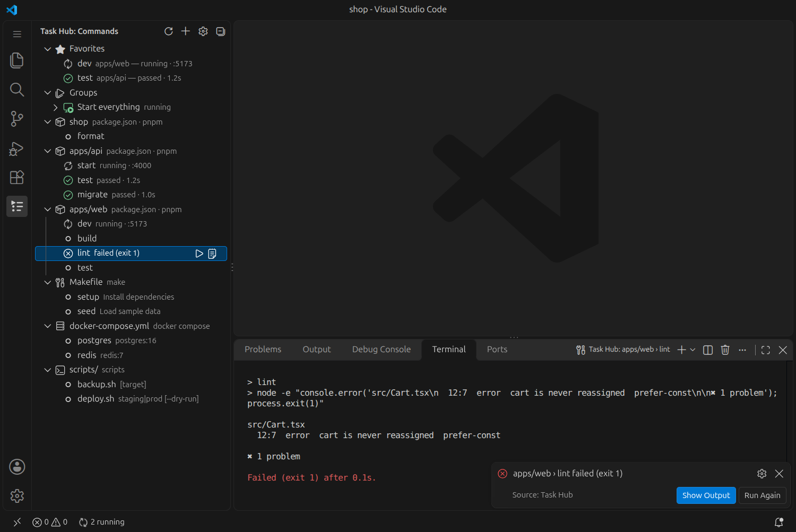
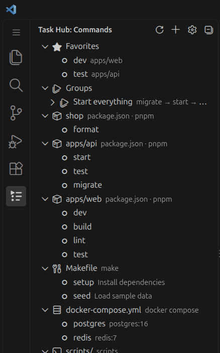
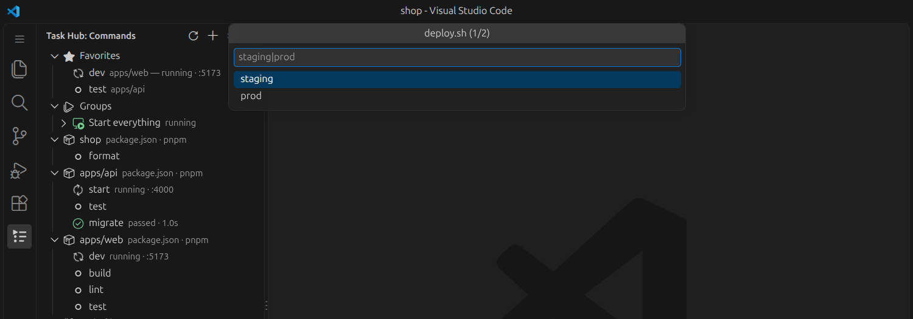
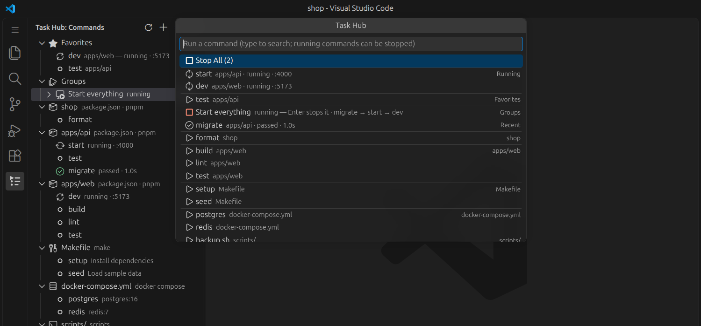
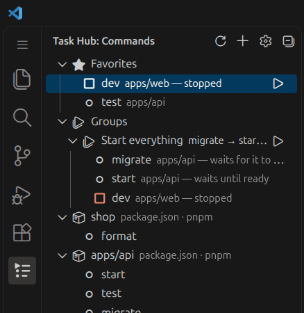

# Task Hub

[](https://open-vsx.org/extension/rajan694/task-hub)
[](LICENSE)

**Every command your project can run, one click away.** Task Hub finds the scripts, targets, tasks and services in your workspace and runs them from a sidebar, with live status, stop and restart, dev-server links and ordered groups. No terminal to open, nothing to type.



## Features

- **Finds every command**: npm, pnpm, yarn and bun scripts (nested `package.json` files and monorepos too), Makefile, justfile, Taskfile, docker compose, Django, Poe, PDM, Maven, Gradle, shell, PowerShell and batch scripts, VS Code tasks, and your own saved commands. Multi-root workspaces work.
- **One click to run, stop or restart.** Each command runs in its own folder. Stop ends the whole process tree, so dev servers really stop.
- **Live status**: running, ready, passed, failed (with the exit code), stopped, and how long it took. It survives a window reload.
- **Dev-server links.** A local URL in the output (`http://localhost:5173/`) shows as `:5173` with an **Open in Browser** button.
- **Script arguments.** PowerShell `param()` blocks, usage lines (`# Usage:`, `echo "Usage: …"`, `Write-Host "Usage: …"`), `getopts` and `case "$1"` become pick lists and text boxes before a run.
- **Groups** start several commands in order, each waiting until the previous one has finished or is ready.
- **Favorites, a status bar item and a quick-pick runner** for the commands you use most.
- **Out of the way**: output goes to a terminal only when you ask for it or a command fails.
- **Team-friendly**: saved commands, groups and favorites live in `.vscode/task-hub.json`, which you can commit.

## Getting started

Click the **Task Hub** icon in the activity bar. Every `package.json`, Makefile, compose file, script folder… gets a heading. Hover a command and click ▶.



| Row shows | Meaning | Buttons |
| --- | --- | --- |
| ○ | Not run yet | Run |
| ⟳ `running · :5173` | Running; a dev-server URL was found | Open in Browser, Stop, Restart |
| ✓ `passed · 3.2s` | Exited with code 0 | Run |
| ✗ `failed (exit 1)` | Exited with an error; its terminal and a notification open | Run, Show Output |
| ■ `stopped` | Stopped by you | Run |
| ▣ `running` (compose) | The service is up, whoever started it | Logs, Stop Service |
| ⚠ `needs bash` | The program the script needs isn't installed | — |

Clicking a row only selects it; nothing runs until you click ▶. Right-click a command for **Run with Arguments…**, **Show Output**, **Go to Definition**, **Copy Command**, **Add to Favorites**, **Add to Group…** and **Save as Command…**. Typing into a command's terminal sends lines to it, and Ctrl+C stops it.

## Where commands come from

| Source | Read from | Runs as |
| --- | --- | --- |
| npm, pnpm, yarn, bun | Every `package.json` outside `node_modules` | `pnpm run dev`, with the package manager from the nearest `packageManager` field or lockfile |
| Make | `Makefile`, `makefile`, `GNUmakefile`; a `## comment` after a target is its description | `make build` |
| just | `justfile`; recipe parameters are asked for | `just deploy staging` |
| Task | `Taskfile.yml` and its variants | `task build` |
| docker compose | `compose.yaml`, `docker-compose.yml`… | `docker compose up -d postgres`, plus Logs and Stop Service |
| Django | `manage.py`: runserver, migrate, makemigrations, test | `.venv/bin/python manage.py migrate` (the project's venv when there is one) |
| Poe, PDM | `[tool.poe.tasks]`, `[tool.pdm.scripts]` in `pyproject.toml` | `poe lint`, `pdm run start` |
| Maven | Every `pom.xml`, one heading per module; `spring-boot:run` with the Spring Boot plugin | `./mvnw -pl api test`, from the project root |
| Gradle | The root project and every `include`d subproject; `run` / `bootRun` with those plugins; **Load All Tasks** fetches the rest once | `./gradlew :api:test`, from the project root |
| Scripts | `*.sh`, `*.bash`, `*.ps1`, and on Windows `*.bat`, `*.cmd` | `bash deploy.sh staging --dry-run`, `pwsh -NoProfile -File backup.ps1 …` |
| VS Code tasks | `.vscode/tasks.json` | VS Code's own task system |
| Saved commands | `.vscode/task-hub.json` | The saved command line |

Every command runs in the folder where it's defined. Maven and Gradle modules run from the project root with the module named, because the build tool needs the whole build.

## Scripts with arguments

A script's row shows what it takes (`env (staging, prod) [--dry-run]`), and ▶ asks for each value first: a pick list when the choices are known, a text box otherwise, filled with what you used last. Switches are one multi-select. Escape cancels. **Restart** and **Run Again** reuse the same arguments.



Task Hub reads, in this order:

- PowerShell `param()` blocks (`Mandatory`, defaults, `[ValidateSet()]`, `[switch]`).
- A usage line, in shell and PowerShell scripts: a `# Usage:` comment, one the script prints (`echo "Usage: ./run.sh …"`, `printf`, `Write-Host 'Usage: .\run.ps1 …'`, a heredoc), the line after a `Usage:` that stands alone, or a comment that starts with the script's own name (`#   ./build.sh <dev|prod> [version]`). In it, `<…>` and `{…}` are required, `[…]` optional, `a|b` a pick list and `<files>...` one or more values. `[--here]` is a switch and `[-n|--dry-run]` one switch with two names. `[--fe=web|mobile]` is a pick list passed as one word (`--fe=web`), and something like `[--emulator[=<avd>]|--device=<serial>]` gets a text box whose words are passed as typed. Options are never required.
- Otherwise, in shell scripts: the `getopts` option string, `case "$1"` branches and the `$1`…`$9` the script uses (named from lines like `env=${1:-staging}`). A function's own `$1` doesn't count, unless the script hands the function its arguments (`main "$@"`).

A script with nothing to read gets one optional text box. Values are passed as an argument list, never pasted into a shell string, so spaces and quotes are safe.

## Favorites, the status bar and the quick pick

Right-click a command → **Add to Favorites** to pin it at the top. While commands run, the status bar shows *⟳ 2 running*. Click it, or run **Task Hub: Run Command…**, for a searchable list of everything, with running commands, groups, favorites and recent runs first. Its buttons stop, restart or show output without leaving the list. **Task Hub: Stop All Commands** stops everything.



## Groups

A group starts several commands in order with one click. Right-click a command → **Add to Group…**, or write the group in `.vscode/task-hub.json`:

```jsonc
{
  "groups": [
    {
      "label": "Start everything",
      "steps": [
        { "run": "compose:root:postgres" },                                    // until `docker compose up -d` is done
        { "run": "npm:apps/api:migrate" },                                     // until it exits with code 0
        { "run": "npm:apps/api:start", "waitFor": "ready", "timeoutSec": 60 }, // until it prints a local URL
        { "run": "npm:apps/web:dev", "waitFor": "ready" }
      ]
    }
  ]
}
```



Each step waits before the next starts: `exit` until the command exits with code 0 (the default for one-shot commands), `ready` until it prints a local URL or its `readyPattern` (120 seconds unless `timeoutSec` says otherwise), `running` just until it has started (the default for dev servers). A failing or timed-out step stops the group there and says which step. **Stop Group** stops its commands, last one first. Steps name commands by id, `<source>:<folder>:<name>` with `root` for the workspace folder; hover a command to see its id.

## Saved commands

Click **+** in the view's title bar to save any command line, or right-click a command → **Save as Command…** to keep it with its arguments (e.g. *Deploy to staging*). They appear under **My commands**:

```jsonc
{
  "commands": [
    { "id": "django", "label": "Django server", "command": "python manage.py runserver", "cwd": "backend", "longRunning": true, "readyPattern": "Starting development server" }
  ],
  "favorites": ["npm:apps/web:dev", "saved:django"]
}
```

Set `taskHub.storage` to `private` to keep saved commands, groups and favorites on your machine instead of in the repository.

## Settings

| Setting | Default | What it does |
| --- | --- | --- |
| `taskHub.sources` | all | Which sources are detected |
| `taskHub.exclude` | `node_modules`, `.venv`, `dist`, `target`, `build`, `.vscode-test` | Folders never scanned (folders hidden by `files.exclude` are skipped too) |
| `taskHub.longRunningNames` | `dev`, `start`, `serve`, `watch`, `run`, `bootRun`, `spring-boot:run` | Command names treated as long-running |
| `taskHub.revealTerminal` | `onFailure` | When to show a command's terminal: `never`, `onFailure` or `always` |
| `taskHub.notify` | `failures` | Which finished commands show a notification: `failures`, `all` or `never` |
| `taskHub.openUrlIn` | `externalBrowser` | Or `simpleBrowser`, inside VS Code |
| `taskHub.storage` | `workspaceFile` | `.vscode/task-hub.json`, or `private` |
| `taskHub.scripts.include` | `*.sh`, `*.bash`, `*.ps1`, `*.bat`, `*.cmd` | Which files count as scripts |
| `taskHub.scripts.runFrom` | `scriptFolder` | Or `workspaceRoot` |
| `taskHub.scripts.maxFiles` | `200` | Stop listing scripts after this many |
| `taskHub.gradle.defaultTasks` | `build`, `test`, `clean`, `assemble` | Gradle tasks shown before **Load All Tasks** |

## Good to know

- **Requirements**: the tools your commands use (Node.js, make, Docker, Java, Python…) on your `PATH`. On Windows, `.sh` scripts need Git Bash or WSL; on Linux and macOS, `.ps1` scripts need PowerShell 7 (`pwsh`). A row says *needs bash* or *needs pwsh* when they're missing.
- **Restricted Mode**: in an untrusted workspace, commands are listed but not run, since running them executes code from the repository.
- **Remote development**: Task Hub runs where your files are, so it works over SSH, in WSL and in Dev Containers.
- **When VS Code closes**, Task Hub stops the commands it started.
- **Privacy**: Task Hub collects no telemetry and sends nothing anywhere.

## Installation

Install **Task Hub** from the VS Code Marketplace or Open VSX.

To install a specific version, download its `.vsix` file from the [GitHub releases](https://github.com/Rajan694/task-hub/releases), then in VS Code open the Extensions view, click `...` and choose **Install from VSIX...**, or run:

```bash
code --install-extension task-hub-X.Y.Z.vsix
```

## License

[MIT](LICENSE)
