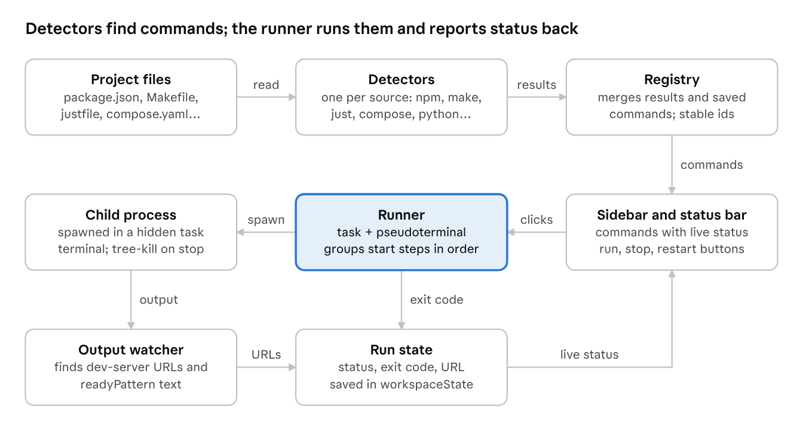

# Task Hub — VS Code Extension Design

Nov 24, 2026 · @Rajan Kumar

Task Hub is a VS Code sidebar that finds every command a project can run and runs it with one click — no terminal to open, nothing to type. Version 1 covers npm-family scripts, Makefile, justfile, docker-compose, Python, Java (Maven, Gradle), shell and PowerShell scripts, VS Code tasks and saved commands, with live status, stop and restart, port links and groups.

## Problem and goals

Running a project command today means opening a terminal, remembering the exact command and package manager, and keeping several terminals alive for servers. Task Hub turns all of that into one panel of buttons.

**Goals**

- Find every runnable command in the workspace automatically, including monorepos and multi-root workspaces.
- Run, stop and restart any command with one click, without the user opening or typing into a terminal.
- Show live status for each command: running, passed, failed (with exit code), how long it took.
- Turn dev-server URLs in the output into an "open" button.
- Start several commands in order with one click (groups).

**Non-goals for v1**

- Not a new task language: Task Hub runs what projects already define, plus simple saved commands.
- Not a terminal replacement: output still lives in a VS Code terminal you can open any time.
- No CI, no remote job runners, no AI.

**How it differs from what exists.** VS Code's built-in NPM Scripts view covers npm only and is hidden by default. The Task Explorer extension detects many task types. Neither is a control panel: neither one gives live status, restart, port links, docker services and ordered groups in one place.

## Sidebar design

Task Hub gets its own icon in the activity bar. Its panel lists commands grouped by where they came from, with Favorites and Groups pinned at the top.

```text
TASK HUB                                       [refresh] [+] [settings]
v Favorites
    dev        npm · apps/web  ● running  :5173   [open] [stop] [restart]
    test       npm · apps/api  ✓ passed 12s ago   [run]
v apps/web  (package.json · pnpm)
    build                                           [run]
    lint                       ✗ failed (exit 1)   [run] [output]
v docker-compose.yml
    postgres                   ● running           [logs] [stop]
v api  (pom.xml · Maven wrapper)
    test                                            [run]
    spring-boot:run                                 [run]
v scripts/
    deploy.sh    env (staging, prod) --dry-run      [run]
    backup.ps1   -Target <path>                     [run]
v My commands
    python manage.py runserver                      [run]
v Groups
    Start everything  (postgres → api → web)        [run]
```

**What each interaction does**

| Where | Action | Result |
| --- | --- | --- |
| Row, click | Select | Nothing runs: only the play button runs a command (decided) |
| Row, inline button | Run / Stop / Restart | Starts, stops or restarts the command; the row icon changes at once. A script with arguments asks for them first |
| Row, inline button | Open (only when a port was found) | Opens the URL in the browser |
| Row, inline button | Output | Shows the command's terminal |
| Row, hover | Tooltip | Full command line, folder it runs in, last run time, duration, exit code |
| Row, right-click | Run with arguments… | Asks for extra arguments, e.g. `-- --watch` |
| Row, right-click | Go to definition | Opens package.json, Makefile, pom.xml, the script, etc. at that command's line |
| Row, right-click | Copy command / Add to favorites / Add to group / Save as command | As named |
| Title bar | + | Saves a new custom command for this project |
| Status bar | ▶ 2 running | Opens a quick list of all commands to run or stop (no keyboard shortcut for now) |

*Settled while building v0.3:* rows under **Favorites** show the heading they come from, then their status (`apps/web — running · :5173`). The status bar item is a bare play icon while nothing runs, so it stays small. **Task Hub: Run Command…** lists each command once, in the first section it belongs to: Running, Favorites, Recent (the last five run), then the sidebar's headings. Enter on a running command offers Stop, Restart, Show Output and Open in Browser instead of starting it twice.

**Row icons** use built-in VS Code icons and theme colors so they match every theme: a spinning `sync` icon while running, `pass` in the test-passed color, `error` in the test-failed color, and `circle-outline` when idle.

## Command sources

Each source is one small detector. Detectors re-run when their files change (debounced 500 ms), and folders like `node_modules`, `.venv` and `dist` are skipped.

| Source | Read from | Shown as | Runs as | Version |
| --- | --- | --- | --- | --- |
| npm-family scripts | Every `package.json`, nested ones included | One group per package, labeled by its folder | `npm run`, `pnpm run`, `yarn` or `bun run`, picked from the nearest `packageManager` field or lockfile, walking up to the repo root | v0.1 |
| Makefile | `Makefile`, `makefile`, `GNUmakefile` | One row per target; a `## comment` after the target becomes its description | `make <target>` | v0.2 |
| justfile | `justfile` | One row per recipe | `just <recipe>` | v0.2 |
| Taskfile | `Taskfile.yml` | One row per task | `task <name>` | v0.2 |
| docker-compose | `compose.yaml`, `compose.yml`, `docker-compose.yml`, `docker-compose.yaml` | One row per service, with up, stop and logs | `docker compose up -d <svc>`, `stop`, `logs -f` | v0.2 |
| VS Code tasks | `.vscode/tasks.json` | One row per task | VS Code's own task runner | v0.2 |
| Saved commands | `.vscode/task-hub.json` | "My commands" group | The saved command line | v0.2 |
| Scripts | `*.sh`, `*.bash`, `*.ps1`, `*.bat`, `*.cmd` | One group per folder; each row shows the arguments the script takes | `bash <file>`, `pwsh -NoProfile -File <file>`, `cmd /d /c <file>`, plus the chosen arguments | v0.2 |
| Python | `manage.py`, `[tool.poe.tasks]` and `[tool.pdm.scripts]` in `pyproject.toml` | Django commands (runserver, migrate, makemigrations, test), Poe and PDM tasks | `python manage.py …`, `poe …`, `pdm run …` | v0.4 |
| Maven | Every `pom.xml`; modules from `<modules>` | One group per module: clean, compile, test, package, install, verify; `spring-boot:run` when the Spring Boot plugin is in the pom | `./mvnw` (or `mvnw.cmd`) when the wrapper exists, else `mvn`; a module with `-pl <module>` | v0.4 |
| Gradle | `build.gradle`, `build.gradle.kts`; subprojects from `include(...)` in `settings.gradle(.kts)` | One group per project: build, test, clean, assemble; `run` with the application plugin, `bootRun` with Spring Boot; **Load all tasks** fetches the rest | `./gradlew` (or `gradlew.bat`) when present, else `gradle`; a subproject as `:api:test` | v0.4 |

**Long-running vs one-shot.** Commands named like `dev`, `start`, `serve` or `watch` (configurable) are treated as long-running: Task Hub expects them to keep running, watches for a port, and offers restart. Everything else is one-shot and gets a pass or fail result.

Java's `spring-boot:run`, `bootRun` and Gradle's `run` are long-running too. **Load all tasks** runs `gradlew tasks --all --console=plain` once, since starting Gradle is slow, and caches the list until a build file changes.

*Settled while building v0.2:*

- **docker compose** rows take their state from `docker compose ps` in the file's folder, not from the `up -d` process (which ends at once). A service shows *running* whoever started it, with **Logs** (`logs -f --tail 200`) and **Stop Service**. The state refreshes after each compose command, when the view becomes visible, and every 15 seconds while it is.
- **justfile** recipe parameters (`deploy env target='web' +files`) are asked for like script arguments.
- **Taskfile** also matches `Taskfile.yaml` and the `.dist` variants, in Task's own order; a folder with several Makefiles, justfiles, Taskfiles or compose files lists only the one the tool would use.
- **PowerShell on Windows** falls back to Windows PowerShell (`powershell.exe`) when PowerShell 7 isn't installed. **bash on Windows** is Git Bash when it's in its usual folder, else whatever `bash` is on `PATH` (WSL's works, since scripts are passed by relative path).
- **VS Code tasks**' Show Output opens the task's own terminal, found by the task's name.
- Reading `tasks.json` and editing `task-hub.json` without losing comments uses Microsoft's `jsonc-parser`, bundled into `dist/extension.js` (still no runtime `node_modules`).

### Nested package.json files

Every `package.json` outside `node_modules` becomes its own group, labeled by its path (`apps/web`, `packages/ui`), and its scripts run in that package's folder. The package manager comes from the nearest `packageManager` field or lockfile found by walking up from the package to the workspace root, because in npm, pnpm, yarn and bun workspaces the lockfile lives only at the root.

### Script arguments

Before running a script that takes arguments, Task Hub asks for them, one prompt per argument. Known choices become a pick list, switches a multi-select, everything else a text box filled with the default or the last value used. Escape cancels without running.

| Script type | Where the arguments come from | Example | Prompt shown |
| --- | --- | --- | --- |
| PowerShell `.ps1` | The `param()` block: names, types, defaults, `[ValidateSet()]`, `[switch]`, `Mandatory` | `[ValidateSet('staging','prod')][string]$Env` | Pick list: staging, prod |
| Shell `.sh` | A `# Usage:` comment line | `# Usage: deploy.sh <env> [--dry-run]` | Text box for env, toggle for --dry-run |
| Shell `.sh` | The `getopts` option string; a `:` after a letter means it takes a value | `getopts "e:d" opt` | Text box for -e, toggle for -d |
| Shell `.sh` | `case "$1" in` branches | `start) … ;; stop) … ;;` | Pick list: start, stop |
| Shell `.sh` | The highest of `$1` to `$9` used | `echo "$2"` | Two text boxes |
| Any script, nothing found | — | — | One optional free-text box |

Each row shows what its script takes, e.g. `env (staging, prod) --dry-run`. After a run, **Restart** reuses the same arguments, and **Save as command** stores the script with its arguments in `.vscode/task-hub.json` (e.g. *Deploy to staging*). Arguments are passed to the process as a list, never pasted into a shell string, so spaces and quotes in values are safe.

**Platform notes.** On Windows, `.sh` scripts need Git Bash or WSL; without one the row shows *needs bash*. On Linux and macOS, `.ps1` scripts need PowerShell 7 (`pwsh`), and `.bat` / `.cmd` scripts are hidden. If PowerShell's execution policy blocks a script, Task Hub shows the error and offers to run it once with `-ExecutionPolicy Bypass`.

## Running commands

Task Hub starts every command as a child process itself, so it sees all output and the exit code. No terminal is created while a command runs; one appears only when the user clicks Output or the command fails, so runs don't fill the terminal list.

**How it works**

1. Task Hub spawns the command with Node's `child_process.spawn` (`shell: true`, the command's folder as `cwd`).
2. Output is kept in memory (the last 1 MB per command) and passed to the output watcher (ports, ready text).
3. **Show Output** creates a terminal backed by a pseudoterminal: it replays the output so far, then follows live. Closing that terminal only closes the view; the command keeps running.
4. On exit, the exit code sets the status. A non-zero code shows a notification: *"lint failed (exit 1)"* with **Show output** and **Run again**.

*Changed while building v0.1:* the first plan ran each command as a `vscode.Task` with a `CustomExecution` and `reveal: Never`. That still adds a terminal tab per run, and the API gives no handle to show a task's terminal later, so Task Hub creates its own terminal on demand instead.

**Trade-off.** A spawned process has no real TTY. Colors are kept with `FORCE_COLOR=1`, and typed input is passed to the process's stdin a line at a time (Ctrl+C stops the command), but tools that insist on a real TTY may behave differently. Each command gets a **Run in normal terminal** option as a fallback, which uses a plain `ShellExecution` (status still works; port detection does not). Tasks from `.vscode/tasks.json` always use VS Code's own runner.

**Statuses**

| Status | Icon | When |
| --- | --- | --- |
| Idle | `circle-outline` | Never run in this session |
| Running | `sync` (spinning) | Process alive |
| Ready | `sync` + port label | Long-running command printed a URL or its ready text |
| Passed | `pass` (green) | Exit code 0 |
| Failed | `error` (red) | Non-zero exit code |
| Stopped | `debug-stop` | Stopped by the user |

The last status, exit code, duration and finish time are saved per workspace, so they survive a reload.

**Stop and restart.** Stop kills the whole process tree, not just the shell — otherwise dev servers keep running. On Linux and macOS the process starts in its own group (`detached: true`) and Task Hub sends `SIGTERM` to the group, then `SIGKILL` after 5 seconds. On Windows it runs `taskkill /pid <pid> /T /F`. Restart = stop, wait for exit, run.

**Port detection.** Each output line is checked against `https?://(localhost|127.0.0.1|0.0.0.0|[::1]):(\d+)`. The first match adds an **Open** button and a `:5173`-style label. Commands can also set a `readyPattern` (e.g. `Compiled successfully`) used by groups.

**Restricted Mode.** In an untrusted workspace Task Hub still lists commands but disables running them (`capabilities.untrustedWorkspaces: limited`), since running project scripts executes code from the repository.

### Where a command runs

Every command runs in the folder where it is defined, in its own hidden terminal named after it (e.g. *Task Hub: apps/web › dev*). Running it again reuses that terminal, and the row's tooltip shows the folder.

| Source | Working folder |
| --- | --- |
| package.json, nested ones too | That package's folder |
| Makefile, justfile, Taskfile, compose file | The folder holding that file |
| Scripts | The script's own folder by default; `taskHub.scripts.runFrom` can switch it to the workspace root |
| Maven, Gradle | The project root, where the wrapper and root build file live, with the module named (`-pl api`, `:api:test`), because the build tool must see the whole multi-module project |
| Python | The folder holding `manage.py` or `pyproject.toml` |
| Saved commands | Their `cwd` field, relative to the workspace folder; the workspace folder when absent |

Scripts start with an argument list (`spawn('bash', [file, ...args])`) instead of a shell string, so argument values are never re-parsed by a shell. All other commands use `shell: true` as in step 1.

## Groups and saved commands

Saved commands, groups and favorites live in `.vscode/task-hub.json`, so a team can commit them and everyone gets the same buttons. Users who don't want that can switch to private storage (VS Code's workspace state) in settings.

```json
{
  "commands": [
    {
      "id": "django-server",
      "label": "Django server",
      "command": "python manage.py runserver",
      "cwd": "backend",
      "longRunning": true,
      "readyPattern": "Starting development server"
    }
  ],
  "groups": [
    {
      "label": "Start everything",
      "steps": [
        { "run": "compose:postgres", "waitFor": "running" },
        { "run": "npm:api:start",    "waitFor": "ready", "timeoutSec": 60 },
        { "run": "npm:web:dev",      "waitFor": "ready" }
      ]
    }
  ],
  "favorites": ["npm:web:dev", "npm:api:test"]
}
```

**Command ids** are `<source>:<package or file>:<name>`, e.g. `npm:web:dev` or `make:root:migrate`, so groups and favorites still work after a reload.

**How a group runs.** Steps start in order. Each step waits before the next one starts:

- `"exit"` — until the command exits with code 0 (for one-shot steps like `migrate`).
- `"ready"` — until a port or the `readyPattern` shows up in the output.
- `"running"` — just until the process has started.

If a step fails or times out, the group stops there and shows which step failed. Stopping a group stops all its running steps in reverse order.

## Architecture



The top row finds commands and re-runs whenever a watched file changes. A click goes from the sidebar to the runner, and the run state feeds live status back to the sidebar.

## Code structure

TypeScript, bundled with esbuild into one `dist/extension.js`. Adding a new source later means adding one file under `detectors/` and registering it.

```text
task-hub/
  package.json
  assets/icon.png               Marketplace icon, 256×256 PNG
  assets/icon.svg               source of icon.png
  assets/activitybar.svg        activity bar icon
  src/
    extension.ts                activate(): wires everything together
    model.ts                    HubCommand, RunState and other shared types
    detectors/
      index.ts                  list of all detectors
      npm.ts  make.ts  just.ts  taskfile.ts
      compose.ts  vscodeTasks.ts  saved.ts  python.ts
      scripts.ts  maven.ts  gradle.ts
    registry.ts                 runs detectors, merges results, watches files
    runner/
      runner.ts                 run / stop / restart, one entry per running command
      hubPty.ts                 pseudoterminal + child_process.spawn
      killTree.ts               process-tree kill for Linux, macOS, Windows
      outputWatcher.ts          port and readyPattern detection
    groups.ts                   ordered group runs
    args/                       reads what a script takes
      ps1Params.ts              param() blocks: names, defaults, ValidateSet, switch
      shArgs.ts                 # Usage: lines, getopts, case "$1", $1..$9
      prompt.ts                 pick lists and text boxes before a run
    state.ts                    run history, saved in workspaceState
    config.ts                   reads .vscode/task-hub.json and settings
    ui/
      treeProvider.ts           the sidebar tree
      statusBar.ts              "2 running" item
      quickPick.ts              run-anything list
      commands.ts               all registered commands
  test/
    fixtures/                   sample package.json, Makefile, compose files
    detectors.test.ts           parser unit tests
    runner.test.ts              integration tests (@vscode/test-electron)
```

**Main types**

```ts
type SourceKind = 'npm' | 'make' | 'just' | 'taskfile' | 'compose' | 'vscode' | 'saved' | 'python' | 'script' | 'maven' | 'gradle';

interface HubCommand {
  id: string;              // "npm:web:dev"
  label: string;           // "dev"
  source: SourceKind;
  groupLabel: string;      // "web (package.json · pnpm)"
  cwd: vscode.Uri;
  commandLine: string;     // "pnpm run dev"
  definedAt?: vscode.Location; // for "Go to definition"
  description?: string;
  longRunning: boolean;
  readyPattern?: RegExp;
  args?: ScriptArg[];      // scripts: what to ask for before running
  extraActions?: { id: string; label: string; commandLine: string }[]; // compose: stop, logs
}

interface CommandDetector {
  readonly source: SourceKind;
  readonly watchGlob: string;  // e.g. "**/package.json"
  detect(folder: vscode.WorkspaceFolder, token: vscode.CancellationToken): Promise<HubCommand[]>;
}

interface ScriptArg {
  name: string;            // "Env", "-e", "$1"
  kind: 'choice' | 'text' | 'switch';
  choices?: string[];      // from ValidateSet or case "$1" branches
  defaultValue?: string;
  required: boolean;
}

type RunStatus = 'idle' | 'running' | 'ready' | 'passed' | 'failed' | 'stopped';

interface RunState {
  status: RunStatus;
  startedAt?: number;
  endedAt?: number;
  exitCode?: number;
  url?: string;            // first detected dev-server URL
}
```

## VS Code contributions and settings

The key `package.json` entries. Each tree row sets a `contextValue` such as `cmd.idle`, `cmd.running` or `cmd.running.url`, and the `when` clauses use it to show only the buttons that make sense.

```json
{
  "icon": "assets/icon.png",
  "extensionKind": ["workspace"],
  "capabilities": { "untrustedWorkspaces": { "supported": "limited" } },
  "activationEvents": ["onStartupFinished"],
  "contributes": {
    "viewsContainers": {
      "activitybar": [{ "id": "taskHub", "title": "Task Hub", "icon": "assets/activitybar.svg" }]
    },
    "views": {
      "taskHub": [{ "id": "taskHub.commands", "name": "Commands" }]
    },
    "commands": [
      { "command": "taskHub.run",     "title": "Run",     "icon": "$(play)" },
      { "command": "taskHub.stop",    "title": "Stop",    "icon": "$(debug-stop)" },
      { "command": "taskHub.restart", "title": "Restart", "icon": "$(debug-restart)" },
      { "command": "taskHub.openUrl", "title": "Open in Browser", "icon": "$(globe)" },
      { "command": "taskHub.showOutput", "title": "Show Output", "icon": "$(output)" },
      { "command": "taskHub.addCommand", "title": "Add Command", "icon": "$(add)" },
      { "command": "taskHub.refresh", "title": "Refresh", "icon": "$(refresh)" },
      { "command": "taskHub.quickRun", "title": "Task Hub: Run Command…" }
    ],
    "menus": {
      "view/title": [
        { "command": "taskHub.refresh",    "when": "view == taskHub.commands", "group": "navigation" },
        { "command": "taskHub.addCommand", "when": "view == taskHub.commands", "group": "navigation" }
      ],
      "view/item/context": [
        { "command": "taskHub.run",     "when": "viewItem =~ /^cmd\\.(idle|passed|failed|stopped)/", "group": "inline" },
        { "command": "taskHub.openUrl", "when": "viewItem == cmd.running.url", "group": "inline" },
        { "command": "taskHub.stop",    "when": "viewItem =~ /^cmd\\.running/", "group": "inline" },
        { "command": "taskHub.restart", "when": "viewItem =~ /^cmd\\.running/", "group": "inline" }
      ]
    }
  }
}
```

`extensionKind: workspace` makes the extension run where the files are, so it also works over SSH, WSL and Dev Containers.

**Settings**

| Setting | Default | What it does |
| --- | --- | --- |
| `taskHub.sources` | all | Which detectors are on |
| `taskHub.exclude` | `**/node_modules/**`, `**/.venv/**`, `**/dist/**`, `**/target/**`, `**/build/**`, `**/.vscode-test/**` | Folders never scanned, besides those hidden by `files.exclude` |
| `taskHub.longRunningNames` | `dev`, `start`, `serve`, `watch`, `run`, `bootRun`, `spring-boot:run` | Names treated as long-running |
| `taskHub.revealTerminal` | `onFailure` | `never`, `onFailure` or `always` |
| `taskHub.notify` | `failures` | `failures`, `all` or `never` |
| `taskHub.openUrlIn` | `externalBrowser` | Or `simpleBrowser` (inside VS Code) |
| `taskHub.storage` | `workspaceFile` | `workspaceFile` (`.vscode/task-hub.json`, decided) or `private` |
| `taskHub.scripts.include` | `**/*.sh`, `**/*.bash`, `**/*.ps1`, `**/*.bat`, `**/*.cmd` | Which files count as scripts |
| `taskHub.scripts.runFrom` | `scriptFolder` | `scriptFolder` or `workspaceRoot` |
| `taskHub.scripts.maxFiles` | `200` | Stops listing scripts after this many, so big repos stay fast |
| `taskHub.gradle.defaultTasks` | `build`, `test`, `clean`, `assemble` | Tasks shown before **Load all tasks** |

## Milestones

Each version works on its own and can be released.

1. **v0.1 — npm in the sidebar.** Activity bar icon, npm/pnpm/yarn/bun scripts from every `package.json` (nested ones included), run and stop with the play button, the six statuses. Done when any script can be run and stopped without touching a terminal.
2. **v0.2 — More sources.** Makefile, justfile, Taskfile, docker-compose services, `.vscode/tasks.json`, saved commands in `.vscode/task-hub.json`, and `.sh` / `.ps1` / `.bat` / `.cmd` scripts with argument prompts.
3. **v0.3 — Control panel.** Port detection with Open button, restart, favorites, status bar item, quick-pick runner, run history that survives reloads.
4. **v0.4 — Groups, Python and Java.** Ordered groups with `exit` / `ready` / `running` waits; Django, Poe and PDM; Maven and Gradle with wrappers, multi-module projects and **Load all tasks**.
5. **v1.0 — Release.** Restricted Mode handling, Windows and macOS testing, detector unit tests, README with GIFs, Marketplace listing.

## Open questions

- [x] Own activity bar icon (current design) or a section inside the Explorer? Answer: awn activity bar icon
- [x] Should saved commands and groups default to the shared `.vscode/task-hub.json`, or to private storage? Answer: yes it will save commands
- [x] Does single-clicking a row run it, or only the play button? (Accidental runs vs. speed.)Answer: only play button
- [x] Default keyboard shortcut for the quick-pick runner, if any.Answer: not now
- [x] Marketplace name and extension ID — check that "Task Hub" is free.

  **Answer (Claude):** A web search on 24 Nov 2026 found no extension named exactly "Task Hub". The extension ID is `<your-publisher>.task-hub`, so it can't clash; only the display name could. Search the Marketplace once more right before publishing.
- [x] Prototype check: confirm the hidden pseudoterminal approach handles colored output and interactive prompts well enough for common tools (Vite, Next.js, Django, docker compose).

  **Answer (Claude):** This gets checked while building v0.1: run Vite, Next.js, Django and docker compose through the hidden terminal and check colors, prompts and Ctrl+C. Leaving it open until then.
- [x] what about the java projects and the nested package json files and the script files like .sh or .ps1(with or without arguments(it should show the arguments to select)), do running  that command will run it in the child folder terminal?

  **Answer (Claude):** Yes to all of these, and each command runs in its own folder. The doc is updated:
  - **Java:** Maven (`pom.xml`) and Gradle (`build.gradle`, `build.gradle.kts`) are now sources, including multi-module projects. See [Command sources](#command-sources).
  - **Nested package.json:** already covered. Each one becomes its own group, and the package manager is found by walking up to the repo's lockfile, so a package inside a pnpm workspace still uses pnpm.
  - **.sh, .ps1, .bat, .cmd scripts:** new Scripts source. Task Hub reads a script's arguments (PowerShell `param()` blocks; `getopts`, `case "$1"` and `# Usage:` lines in shell scripts) and asks for them before running, with a pick list when the choices are known. See **Script arguments**.
  - **Folder:** every command runs in the folder where it is defined, in its own terminal. Two exceptions: Maven and Gradle modules run from the project root with the module named (`-pl api`, `:api:test`), and scripts can be set to run from the workspace root. See **Where a command runs** under [Running commands](#running-commands).
